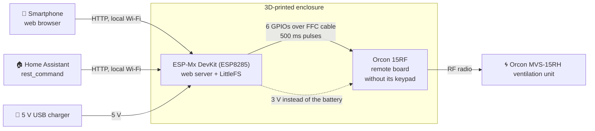
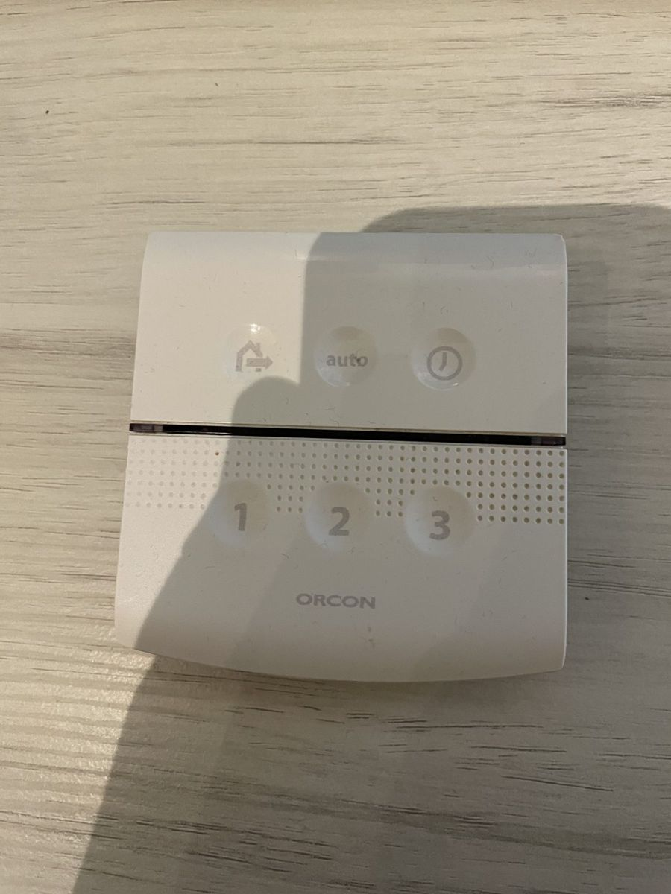
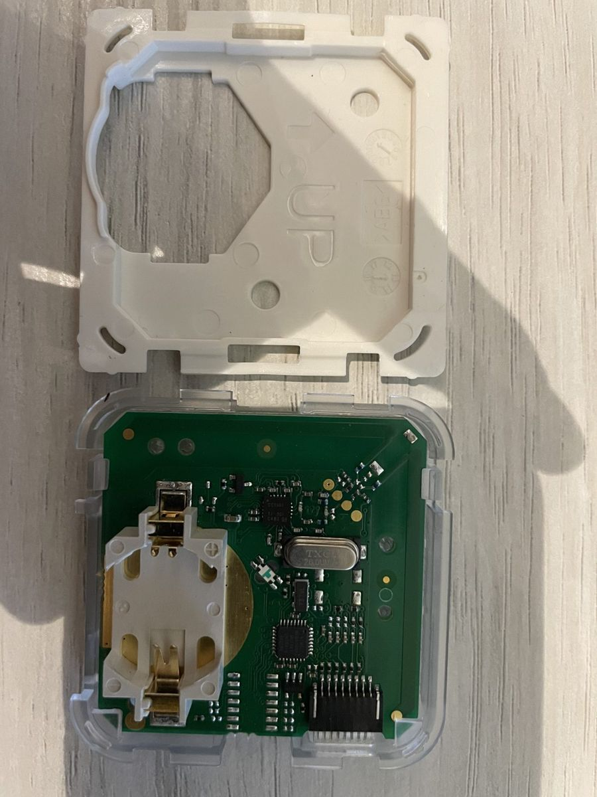
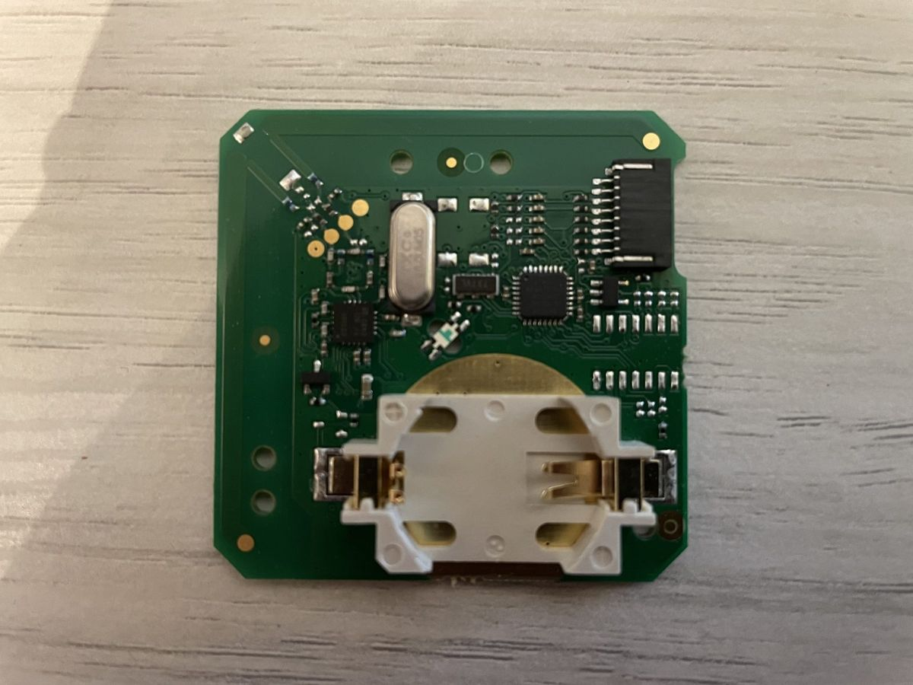
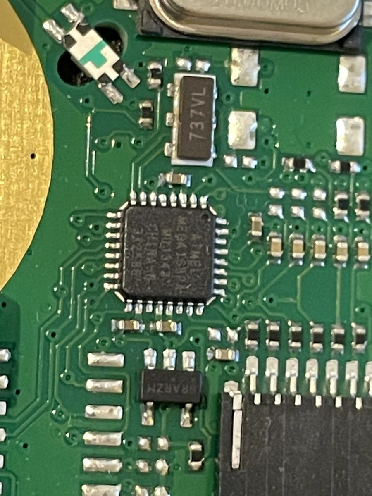
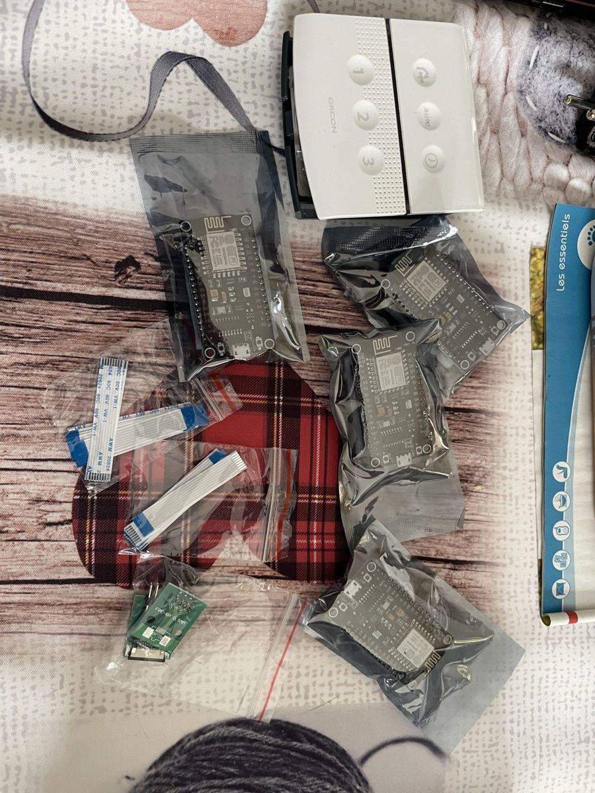
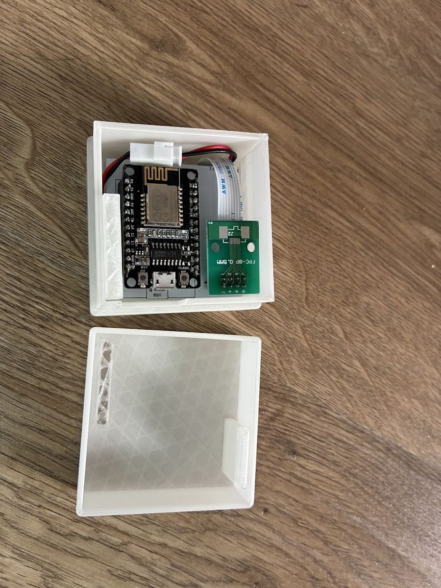
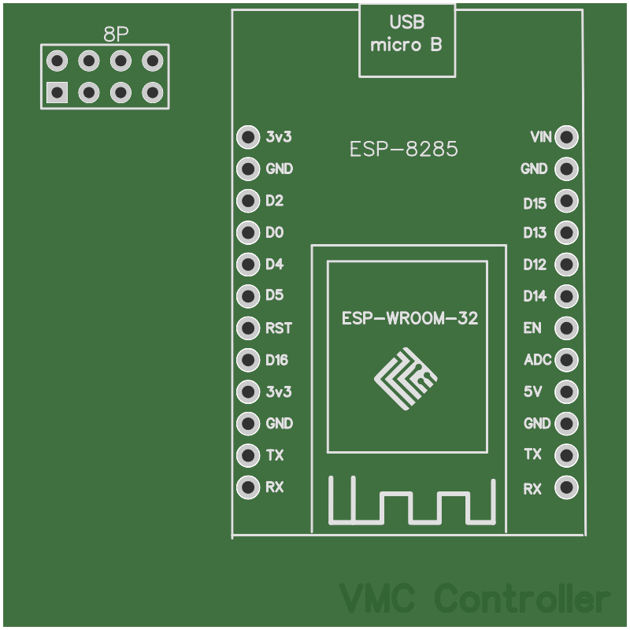
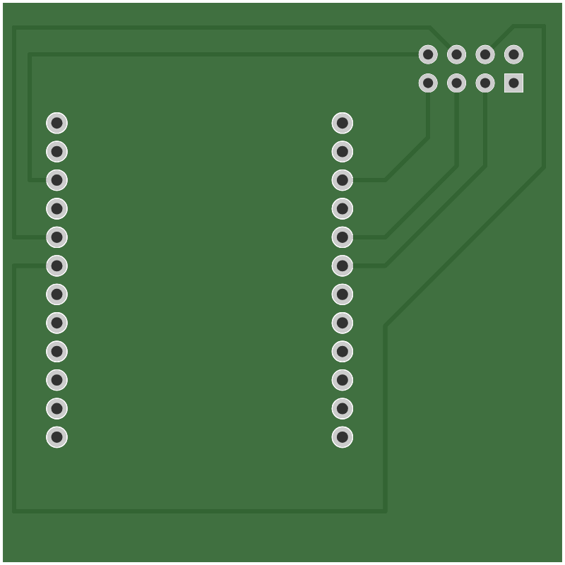

# VMC Controller

Wi‑Fi remote control for an **Orcon MVS‑15RH** ventilation unit (MVHR/extract fan, "VMC" in French), based on an ESP8266.

The original RF remote (Orcon 15RF) was taken apart: its keypad was replaced by an ESP8266 that "presses" the buttons instead. The ventilation unit can then be controlled from a smartphone (web page on the local network) and from Home Assistant, without touching the unit itself or the radio protocol.

> Personal project, meant for a private local network. The interface has **no authentication**: do not expose it to the Internet.

---

## Contents

1. [How it works](#how-it-works)
2. [Hardware](#hardware)
3. [Wiring](#wiring)
4. [Photos of the remote](#photos-of-the-remote)
5. [Final assembly](#final-assembly)
6. [Printed circuit board](#printed-circuit-board)
7. [Software](#software)
8. [Installation](#installation)
9. [Tests](#tests)
10. [Usage](#usage)
11. [HTTP API](#http-api)
12. [Home Assistant integration](#home-assistant-integration)
13. [How the ventilation unit works](#how-the-ventilation-unit-works)
14. [Troubleshooting](#troubleshooting)
15. [Known limitations](#known-limitations)
16. [Ideas for improvement](#ideas-for-improvement)
17. [License](#license)

---

## How it works



- The ESP8266 connects to the home Wi‑Fi and serves a small web page.
- Each button on the page matches a button on the remote. The ESP pulls the matching output LOW for 500 ms, which simulates a press.
- The remote board then sends the radio command to the ventilation unit, as if the button had been pressed.
- The ESP powers the remote board from its 3 V output, instead of the battery. The ESP itself is powered by a USB charger.
- Everything fits in a 3D-printed enclosure.

## Hardware

| Item | Details |
|---|---|
| Ventilation unit | Orcon MVS‑15RH (single-flow extract ventilation, 4 positions + auto mode with humidity sensor) |
| Remote | Orcon 15RF, taken apart, keypad removed |
| Microcontroller | DOIT ESP‑Mx DevKit development board (ESP8285, an ESP8266 variant with built-in flash memory), PlatformIO environment `espmxdevkit` |
| Printed circuit board | Home-made 50 × 50 mm PCB that connects the ESP to the FFC breakout (see [Printed circuit board](#printed-circuit-board)) |
| Keypad link | 8-pin, 1.0 mm pitch flexible flat cable (FFC) and FFC breakout, instead of the keypad membrane |
| Power | 5 V USB charger to the ESP, ESP 3 V output to the remote board |
| Enclosure | 3D-printed |

### Bill of materials

Parts used in the build, checked against the [photos](#final-assembly) and the [PCB](#printed-circuit-board). The links are the listings the parts were bought from. Listings change or disappear, so check the specifications below rather than the listing title.

| Qty | Part | Specifications to check | Where to buy |
|---|---|---|---|
| 1 | Orcon 15RF remote | The remote paired with the ventilation unit, opened and keypad membrane removed | Existing remote |
| 1 | ESP8266 development board | DOIT ESP‑Mx DevKit: ESP‑M2 module (ESP8285), CH340 USB chip, micro‑USB, 2 rows of 12 pins, rows 25.4 mm apart. A NodeMCU board (2 rows of 15 pins) does not fit the PCB footprint. | [Amazon](https://www.amazon.fr/dp/B076Q77M1Z) |
| 1 | Flexible flat cable (FFC) | 8 pins, **1.0 mm pitch**, AWM 20624. It goes from the remote's keypad connector to the breakout. Check the length and whether the contacts are on the same side at both ends (type A) or on opposite sides (type B) against your own build. | [AliExpress](https://www.aliexpress.com/item/1005007561337665.html) |
| 1 | FFC breakout | 8-pin FPC adapter board with a **1.0 mm** flip-lock, bottom-contact connector soldered on, and straight 2.54 mm pins. The board silkscreen says `FPC-8P 0.5MM`: that is the unused pad row on the other side, the connector actually soldered is 1.0 mm. | [AliExpress](https://www.aliexpress.com/item/1005012643948143.html) (variant `Straight-8P`) |
| 1 | Home-made PCB | 50 × 50 mm, Gerber files in [`hardware/pcb/gerber/`](hardware/pcb/gerber/) | JLCPCB or another PCB maker |
| 1 | Power cable to the remote | Red and black wires from the ESP 3 V and GND to the battery holder, with a 2-pin detachable connector | Any |
| 1 | USB charger and micro‑USB cable | 5 V, any phone charger | Any |
| 1 | Enclosure | 3D-printed, STL files in [`hardware/enclosure/`](hardware/enclosure/) | 3D printer |

## Wiring

The original keypad is a flexible membrane with a ribbon that plugs into a connector on the remote board (see the [photos](#photos-of-the-remote) and the [final assembly](#final-assembly)). The membrane is removed and replaced by an FFC cable connected to the ESP through a breakout, which avoids soldering on the Orcon board.

Each ESP output is connected to one of the 6 button contacts of the keypad connector. At rest, the outputs are HIGH. A press is a 500 ms LOW state.

| Remote button | Function | Keypad contact | ESP8266 GPIO | Name in the code |
|---|---|---|---|---|
| 1 | Low position | 1 | GPIO2 | `PIN_LOW` |
| 2 | Medium position | 2 | GPIO15 | `PIN_MEDIUM` |
| 3 | High position | 3 | GPIO4 | `PIN_HIGH` |
| House | Default position | 4 | GPIO12 | `PIN_DEFAULT` |
| Auto | Automatic mode | 5 | GPIO5 | `PIN_AUTO` |
| Timer (clock) | Temporary high position | 6 | GPIO14 | `PIN_MAX` |
| Activity LED | On while a command is being sent | | GPIO16 | `PIN_LED` |

The contact numbers match the `// 1` to `// 6` comments in the code, and the 6 button contacts of the remote's keypad connector. On the ESP‑Mx DevKit and on the PCB, pins are labelled directly with their GPIO number (for example `D15` or `15` for GPIO15).

Power:

- 5 V USB charger to the ESP's USB input.
- ESP 3 V output and GND to the remote's battery holder (CR2032).

> GPIO2 and GPIO15 are also used to select the ESP8266 boot mode (GPIO2 must be HIGH and GPIO15 LOW at boot). If the ESP refuses to boot after a wiring change, check these two pins first.

## Photos of the remote

Orcon 15RF remote taken apart, before modification. The photos are in [`docs/photos/`](docs/photos/).

| | |
|---|---|
|  |  |
| Front: House, Auto, Timer, 1, 2, 3 buttons | Open: CR2032 battery and label (VMN‑15LF01) |
|  |  |
| Keypad and wall frame separated | Circuit board in its transparent holder |
|  |  |
| Keypad membrane: 6 contacts and its ribbon | Board, component side |
|  |  |
| Keypad ribbon connector (on the left) | Close-up of the microcontroller |
|  |  |
| Back of the board, contact pads | Parts of the build: ESP boards, FFC cables, 8-pin FFC breakout |

## Final assembly

| | |
|---|---|
|  |  |
| Remote board and ESP‑Mx DevKit, mounted on the home-made PCB. The FFC cable links the keypad connector to the 8-pin FFC breakout, and the red and black wires bring the ESP's 3 V to the battery holder, through a detachable connector. | ESP and FFC breakout in the enclosure, micro‑USB socket reachable from the side. |
|  | |
| 3D-printed enclosure, closed and powered over USB. The LED shows through the plastic. | |

### Enclosure files

The enclosure STL files are in [`hardware/enclosure/`](hardware/enclosure/). Dimensions read from the files, in mm:

| File | Dimensions (L × W × H) | Likely part |
|---|---|---|
| [`enclosure-bottom.stl`](hardware/enclosure/enclosure-bottom.stl) | 62 × 62 × 38 | Bottom of the enclosure |
| [`enclosure-lid.stl`](hardware/enclosure/enclosure-lid.stl) | 62 × 62 × 24 | Lid, which fits onto the bottom |
| [`board-plate.stl`](hardware/enclosure/board-plate.stl) | 53 × 53 × 1 | Plate that holds the boards |

GitHub shows a 3D preview of an STL file when you click on it.

## Printed circuit board

A small 50 × 50 mm PCB, designed in EasyEDA (April 2021) and made by JLCPCB, holds the ESP‑Mx DevKit and the FFC breakout. It replaces the loose wiring between the two.

| Top | Bottom (seen from below) |
|---|---|
|  |  |

- **Top side**: silkscreen of the ESP‑Mx DevKit footprint (2 rows of 12 pins) and of the `8P` connector (2 × 4 pins) that takes the FFC breakout.
- **Bottom side**: 6 traces connect the `8P` connector to GPIOs 2, 4, 5, 12, 14 and 15, that is the 6 buttons driven by the firmware.
- **Dimensions**: ESP rows 25.4 mm apart, 2.54 mm pitch, 1.0 mm holes for the ESP and 0.889 mm holes for the `8P` connector.

The Gerber files are in [`hardware/pcb/gerber/`](hardware/pcb/gerber/). They can be sent as they are to a manufacturer such as JLCPCB, once zipped.

> The manufactured PCB did not fit perfectly and the parts had to be forced in a little. Before ordering a new batch, measure the actual row spacing of your ESP board and the position of the connector, then fix the footprint if needed.

## Software

| | |
|---|---|
| Environment | [PlatformIO](https://platformio.org/) (VS Code extension recommended in `.vscode/extensions.json`) |
| Framework | Arduino for ESP8266 (`espressif8266`) |
| Web server | [ESPAsyncWebServer](https://github.com/ESP32Async/ESPAsyncWebServer) and [ESPAsyncTCP](https://github.com/ESP32Async/ESPAsyncTCP), maintained by ESP32Async, versions pinned in `platformio.ini` |
| Updates over Wi‑Fi | ArduinoOTA (included in the Arduino core) |
| File system | LittleFS (web pages stored in flash) |
| Interface | Plain HTML and JavaScript, [Milligram](https://milligram.io/) CSS |

Layout:

```
├── platformio.ini       PlatformIO configuration (board, libraries, LittleFS)
├── src/main.cpp         Firmware: Wi‑Fi, web server, GPIO control
├── include/
│   ├── wifi.h.example   Template for the Wi‑Fi credentials
│   └── wifi.h           Your copy with the credentials (not in Git)
└── data/                Files uploaded to LittleFS
    ├── index.html       Remote control page
    ├── script.js        Sends commands and refreshes the mode
    ├── style.css        Layout
    └── milligram.min.css
```

How the firmware works (`src/main.cpp`):

- `setup()` connects the ESP to Wi‑Fi with the hostname `vmc`, sets up the GPIOs and starts the web server. At boot, it sends the **Medium** command, which puts the ventilation unit in a known state.
- HTTP requests only record the requested command. `loop()` runs it, so the server is not blocked during the delays.
- The current mode is remembered by the ESP. It is not read from the ventilation unit, which sends nothing back.

## Installation

### 1. Requirements

- VS Code with the PlatformIO extension, or PlatformIO Core on the command line.
- A USB cable to flash the ESP.

### 2. Wi‑Fi credentials

Copy the template `include/wifi.h.example` to `include/wifi.h`, which is excluded from Git:

```bash
cp include/wifi.h.example include/wifi.h
```

Then put your network name and password in the copy, and choose a password for updates over Wi‑Fi:

```cpp
#pragma once

const char *ssid = "NETWORK_NAME";
const char *password = "PASSWORD";

#define OTA_PASSWORD "OTA_PASSWORD"
```

Without the `OTA_PASSWORD` line, the firmware still builds (with a warning) but only accepts updates over USB.

### 3. Build and flash the firmware

```bash
pio run --target upload
```

### 4. Upload the web interface to LittleFS

```bash
pio run --target uploadfs
```

Repeat this step every time a file in the `data/` folder changes.

### 5. Check

```bash
pio device monitor
```

The serial monitor (115200 baud) shows the list of LittleFS files, then the IP address obtained. The page is then available at `http://vmc/` (if your router resolves hostnames) or `http://<ip-address>/`. It is a good idea to reserve a fixed IP address for the ESP in the router, especially for Home Assistant.

### 6. Updates over Wi‑Fi (OTA)

Once the first flash over USB is done and the ESP is on Wi‑Fi, the next updates can go over the network, without opening the enclosure. The ESP announces itself as `vmc.local` (mDNS) and asks for the `OTA_PASSWORD` from `include/wifi.h`:

```bash
export PLATFORMIO_UPLOAD_FLAGS="--auth=OTA_PASSWORD"   # your OTA password
pio run --target upload --upload-port vmc.local        # firmware
pio run --target uploadfs --upload-port vmc.local      # web interface
```

Add `-e nodemcuv2` for the test board. If `vmc.local` does not resolve, use the ESP's IP address instead. The computer must be on the same network, and its firewall must let the ESP connect back to it (espota uses a random TCP port).

The production board (ESP‑Mx DevKit) only has 1 MB of flash, 256 KB of which hold the web interface. An update over Wi‑Fi needs room for the old and the new firmware at the same time: if the build is larger than about half of the remaining space, the ESP refuses the update and USB is still needed.

## Tests

Unit tests check the firmware on the computer, without an ESP or a remote:

```bash
pio test -e native
```

`src/main.cpp` is compiled **as is**: the tests only replace the Arduino, Wi‑Fi, LittleFS and web server libraries with fakes (folder `test/mocks/`). These fakes record every pin change and every pause, which makes it possible to check, for example:

- that at boot all pins are outputs and released, then that Medium is sent;
- that each URL presses the right button, with a 500 ms pulse and the LED on while sending;
- that Max 15/30/60 min presses Timer 1, 2 or 3 times, 600 ms apart, then that `/mode` goes back to the previous mode when the time is up;
- that Max commands are ignored in High mode (current behaviour, see [Known limitations](#known-limitations));
- that pages are served from LittleFS and that an unknown URL answers `404`.
- that OTA only starts once Wi‑Fi is connected, with the `vmc` name and the password, and that it unmounts LittleFS before a web interface update.

The tests also run automatically on GitHub (*Actions* tab) on every push and pull request, together with a firmware build for both ESP boards (production and test).

### Test board (NodeMCU)

To try changes without touching the VMC, the same firmware can run on a spare **NodeMCU v3** board (LoLin, ESP‑12 module with 4 MB flash, CH340 USB chip). The code is unchanged; only the PlatformIO environment differs:

```bash
pio run -e nodemcuv2 --target upload     # firmware
pio run -e nodemcuv2 --target uploadfs   # web interface (data/)
pio device monitor
```

`pio run` without `-e` still builds the production board (`espmxdevkit`) only.

A NodeMCU labels its pins `D0`…`D8` instead of GPIO numbers:

| Button | GPIO | NodeMCU pin | Notes |
|---|---|---|---|
| 1 (`PIN_LOW`) | GPIO2 | `D4` | Boot pin, must be HIGH at boot. Also drives the blue LED of the ESP‑12 module, which lights up on each Low press. |
| 2 (`PIN_MEDIUM`) | GPIO15 | `D8` | Boot pin, must be LOW at boot (10 kΩ pull-down on the board). |
| 3 (`PIN_HIGH`) | GPIO4 | `D2` | |
| House (`PIN_DEFAULT`) | GPIO12 | `D6` | |
| Auto (`PIN_AUTO`) | GPIO5 | `D1` | |
| Timer (`PIN_MAX`) | GPIO14 | `D5` | |
| Activity LED (`PIN_LED`) | GPIO16 | `D0` | Also drives the board's red LED, which lights up during every command. |

None of these pins is used by the flash memory or the USB serial link, and the boot pins are only driven after boot, so the NodeMCU starts normally with nothing connected.

**Testing without the remote**: with nothing wired, the board's two LEDs and the serial monitor (which prints each command received) are already enough to check the web interface and Home Assistant. To see every button, wire one LED per output, with a 330 Ω to 1 kΩ resistor:

- `D1`, `D2`, `D4`, `D5`, `D6`: from `3V3` through the resistor and the LED to the pin (cathode on the pin side). The LED lights up during the 500 ms press, like the remote button.
- `D8` (GPIO15): wire it the other way, from the pin through the resistor and the LED to `GND`. An LED pulled up to `3V3` could hold GPIO15 HIGH at boot and stop the board from starting. This LED is lit at rest and goes off during a Medium press.

## Usage

| | |
|---|---|
|  |  |
| At boot, the ESP sends Medium | After pressing "Max 30 min" |

The page shows the last mode sent (refreshed every 2 seconds, matching button highlighted) and eight buttons:

| Button | Effect on the ventilation unit |
|---|---|
| Default | Default position, very low consumption, ignores the sensors |
| Auto | Auto mode, driven by the built-in humidity sensor |
| Low | Position 1 (low) |
| Medium | Position 2 (medium) |
| High | Position 3 (high) |
| Max 15 min | Position 3 for 15 min, then back to the previous position |
| Max 30 min | Position 3 for 30 min, then back to the previous position |
| Max 60 min | Position 3 for 60 min, then back to the previous position |

The "Max" modes match the remote's Timer button, pressed 1, 2 or 3 times. They are ignored if the current mode is already High.

## HTTP API

All routes are `GET`, on port 80.

| Route | Response | Purpose |
|---|---|---|
| `/` or `/index.html` | HTML page | Web interface |
| `/default` | empty `200` | Default position |
| `/auto` | empty `200` | Automatic mode |
| `/low` | empty `200` | Low position |
| `/medium` | empty `200` | Medium position |
| `/high` | empty `200` | High position |
| `/max1` | empty `200` | High position for 15 min |
| `/max2` | empty `200` | High position for 30 min |
| `/max3` | empty `200` | High position for 60 min |
| `/mode` | `text/plain` | Current mode: `Default`, `Auto`, `Low`, `Medium`, `High`, `Max 15 min`, `Max 30 min` or `Max 60 min` |

The `200` is sent as soon as the command is recorded, before it runs. Example:

```bash
curl http://vmc/high
curl http://vmc/mode   # -> High
```

## Home Assistant integration

Home Assistant controls the ventilation unit with `rest_command`, and can read the mode with a `rest` sensor. Example configuration (`configuration.yaml`):

```yaml
rest_command:
  vmc_default: { url: "http://vmc/default" }
  vmc_auto:    { url: "http://vmc/auto" }
  vmc_low:     { url: "http://vmc/low" }
  vmc_medium:  { url: "http://vmc/medium" }
  vmc_high:    { url: "http://vmc/high" }
  vmc_max15:   { url: "http://vmc/max1" }
  vmc_max30:   { url: "http://vmc/max2" }
  vmc_max60:   { url: "http://vmc/max3" }

sensor:
  - platform: rest
    name: VMC mode
    resource: http://vmc/mode
    scan_interval: 30
```

Replace `vmc` with the ESP's IP address if your network does not resolve the hostname. The commands can then be called from dashboard buttons or automations, for example "Max 30 min" when the bathroom humidity goes above a threshold.

## How the ventilation unit works

Summary of the Orcon MVS‑15RH manual, useful to understand the commands:

- **4 positions**: default, low (1), medium (2), high (3). The airflow of each position is set with the DIP switches on the unit's board (curve tables A and B in the installer manual).
- **Auto mode**: the unit measures humidity continuously. If it rises by more than 5 to 10 % in 3 minutes, the unit switches to position 2 or 3, then goes back to auto after 15 or 30 minutes depending on DIP switch 8.
- **Timer**: 1, 2 or 3 presses give the high position for 15, 30 or 60 minutes, then the unit goes back to the last position chosen. Pressing another button stops the timer.
- **After a power cut**, the unit restarts in automatic mode.
- **Pairing a remote**: unplug the unit for 5 seconds, plug it back in, then within 3 minutes press `1` and `Auto` on the remote at the same time until its LED blinks. With this build, pairing needs both outputs to be driven at the same time, which the firmware does not do today (see the ideas for improvement).
- **Resetting the remote**: press Default and Timer together for 3 seconds.

## Troubleshooting

Start with the serial monitor (`pio device monitor`, 115200 baud, ESP connected over USB). At boot it lists the LittleFS files, then prints `Connection established` and the IP address. Each command received is printed too.

| Symptom | What to check |
|---|---|
| The page at `http://vmc/` does not open | Try `http://<ip-address>/` with the address from the serial monitor: some routers do not resolve the `vmc` hostname. |
| `Connection established` never shows | The Wi‑Fi network or password has changed (new Internet box, for example). Update `include/wifi.h`, then build and flash again. |
| The page is blank or returns an error, but `/mode` answers | The LittleFS file list is empty in the serial monitor: upload the interface with `pio run --target uploadfs`. |
| The ESP does not start after a wiring change | Check GPIO2 (must be HIGH at boot) and GPIO15 (must be LOW at boot), see [Wiring](#wiring). |
| The ESP LED (GPIO16) lights up during a command, but the ventilation unit does not react | Check the FFC cable and breakout, and the 3 V power to the remote's battery holder. If the remote board is powered and connected, it may no longer be paired (after replacing or resetting the unit, for example): pair it again, see [How the ventilation unit works](#how-the-ventilation-unit-works). |
| The mode shown does not match the ventilation unit | Expected: the ESP only knows the last mode it sent, see [Known limitations](#known-limitations). |

## Known limitations

- **No authentication**: anyone on the local network can control the ventilation unit.
- **Estimated mode**: the mode shown is the one from the last command sent by the ESP. A command sent by another remote, a return to auto mode after a power cut, or a timer ending on the unit side are not seen by the ESP.
- **Max mode duration**: the ESP computes the end of the Max mode with the internal clock (`time(0)`), without NTP sync. This is enough for a relative duration, but has not been checked in detail.
- **Max ignored in High**: Max commands are silently ignored if the current mode is High.
- **Requests close together**: only one command is stored at a time, and it is cleared once it has run. A command received while another one is being sent (up to about 3 seconds for Max 60 min) can therefore be lost.
- **Updates over Wi‑Fi**: protected by a password, but sent unencrypted over the local network.

## Ideas for improvement

What the project is missing (pairing from the interface, reset button, Wi‑Fi setup, more compact version, MQTT…) is detailed in the [roadmap](ROADMAP.md).

## License

This project (code, enclosure and PCB files) is released under the [MIT](LICENSE) license. The [Milligram](https://milligram.io/) stylesheet included in `data/` is also under the MIT license.
