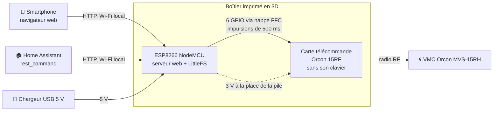
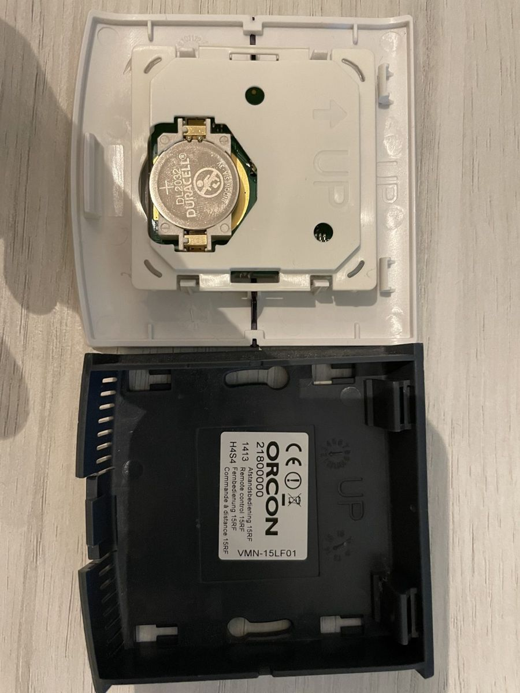
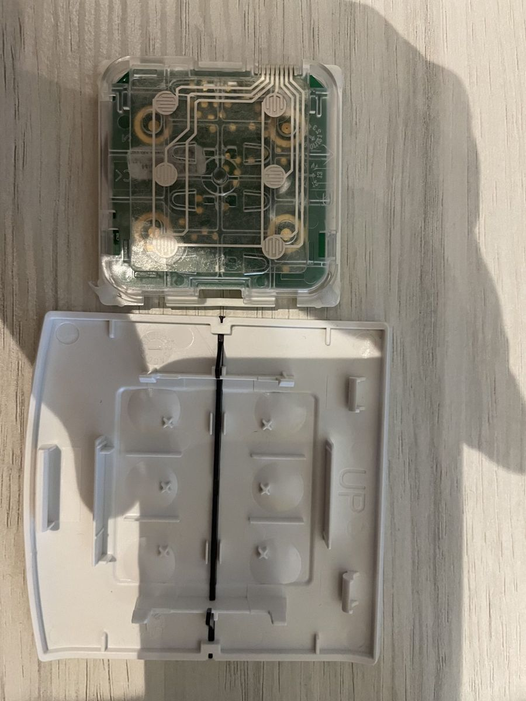
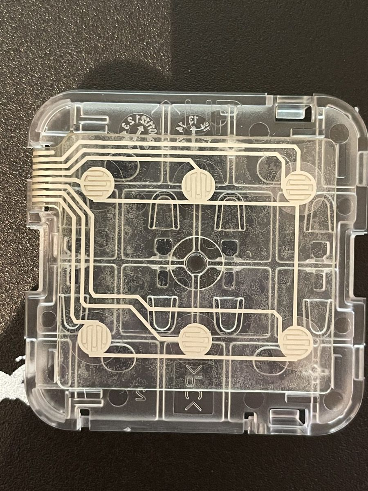
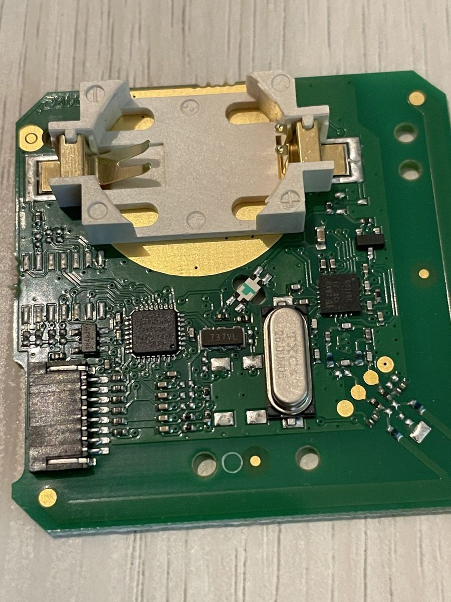
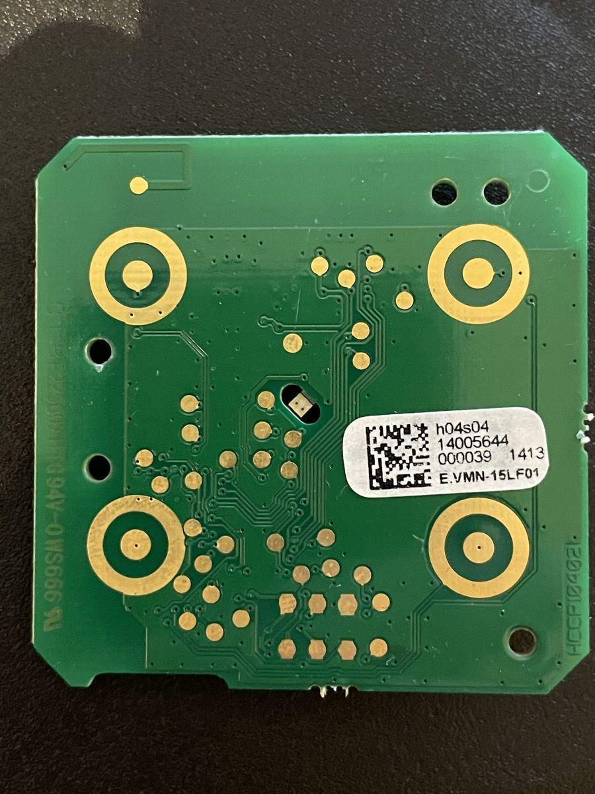
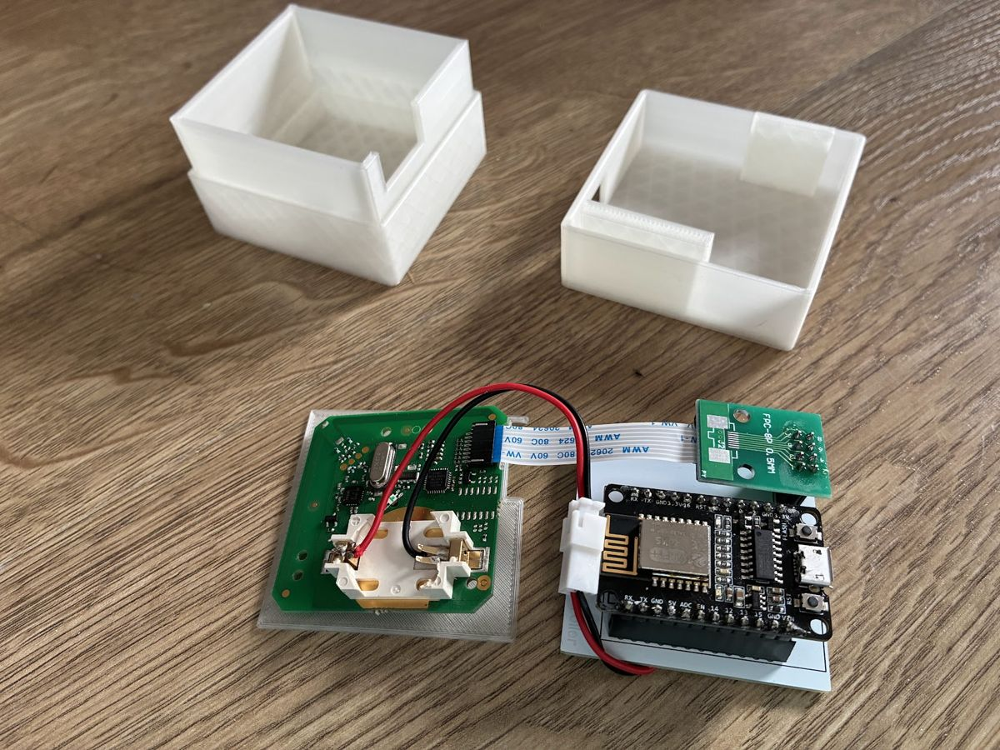
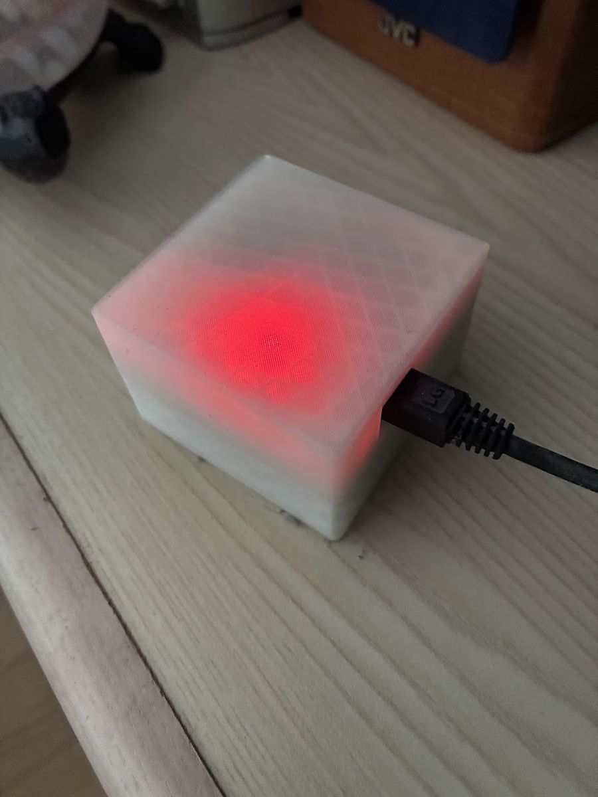
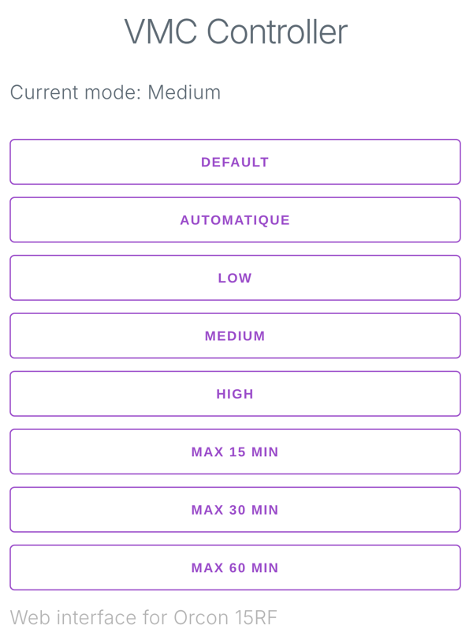
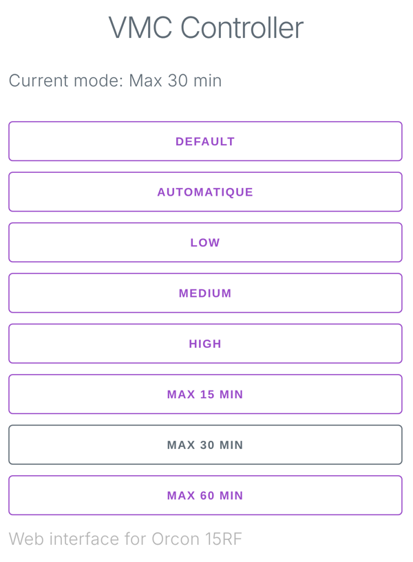

# VMC Controller

Télécommande Wi‑Fi pour une VMC **Orcon MVS‑15RH**, basée sur un ESP8266.

La télécommande RF d'origine (Orcon 15RF) a été démontée : son clavier a été remplacé par un ESP8266 qui « appuie » sur les boutons à sa place. La VMC se pilote ainsi depuis un smartphone (page web sur le réseau local) et depuis Home Assistant, sans toucher à la VMC elle‑même ni au protocole radio.

> Projet personnel, prévu pour un réseau local privé. L'interface n'a **aucune authentification** : ne l'exposez pas sur Internet.

---

## Sommaire

1. [Principe](#principe)
2. [Matériel](#matériel)
3. [Câblage](#câblage)
4. [Photos de la télécommande](#photos-de-la-télécommande)
5. [Montage final](#montage-final)
6. [Logiciel](#logiciel)
7. [Installation](#installation)
8. [Utilisation](#utilisation)
9. [API HTTP](#api-http)
10. [Intégration Home Assistant](#intégration-home-assistant)
11. [Rappel du fonctionnement de la VMC](#rappel-du-fonctionnement-de-la-vmc)
12. [Limites connues](#limites-connues)
13. [Pistes d'amélioration](#pistes-damélioration)

---

## Principe



- L'ESP8266 se connecte au Wi‑Fi de la maison et sert une petite page web.
- Chaque bouton de la page correspond à un bouton de la télécommande. L'ESP met la sortie correspondante à l'état bas pendant 500 ms, ce qui simule un appui.
- La carte de la télécommande émet ensuite la commande radio vers la VMC, comme si on avait appuyé sur le bouton.
- L'ESP alimente la carte de la télécommande par sa sortie 3 V, à la place de la pile. L'ESP est lui‑même alimenté par un chargeur USB.
- L'ensemble tient dans un boîtier imprimé en 3D.

## Matériel

| Élément | Détail |
|---|---|
| VMC | Orcon MVS‑15RH (ventilation simple flux, 4 positions + mode auto avec détecteur d'humidité) |
| Télécommande | Orcon 15RF, démontée, clavier retiré |
| Microcontrôleur | Carte de développement ESP8266 type NodeMCU v3 (ESP‑12), environnement PlatformIO `espmxdevkit` |
| Liaison clavier | Nappe souple (FFC) et adaptateur FFC 8 broches au pas de 0,5 mm, à la place de la membrane du clavier |
| Alimentation | Chargeur USB 5 V vers l'ESP, sortie 3 V de l'ESP vers la carte de la télécommande |
| Boîtier | Imprimé en 3D |

## Câblage

Le clavier d'origine est une membrane souple avec une nappe qui s'enfiche sur un connecteur de la carte de la télécommande (voir les [photos](#photos-de-la-télécommande) et le [montage final](#montage-final)). La membrane est retirée et remplacée par une nappe FFC reliée à l'ESP par un adaptateur, ce qui évite de souder sur la carte Orcon.

Chaque sortie de l'ESP est reliée à l'un des 6 contacts de boutons du connecteur clavier. Au repos, les sorties sont à l'état haut. Un appui correspond à un état bas de 500 ms.

| Bouton télécommande | Fonction | Contact clavier | GPIO ESP8266 | Broche NodeMCU | Repère dans le code |
|---|---|---|---|---|---|
| 1 | Position basse | 1 | GPIO2 | D4 | `PIN_LOW` |
| 2 | Position moyenne | 2 | GPIO15 | D8 | `PIN_MEDIUM` |
| 3 | Position élevée | 3 | GPIO4 | D2 | `PIN_HIGH` |
| Maison | Position défaut | 4 | GPIO12 | D6 | `PIN_DEFAULT` |
| Auto | Mode automatique | 5 | GPIO5 | D1 | `PIN_AUTO` |
| Timer (horloge) | Position élevée temporaire | 6 | GPIO14 | D5 | `PIN_MAX` |
| LED d'activité | Allumée pendant l'envoi d'une commande | | GPIO16 | D0 (LED de la carte) | `PIN_LED` |

Les numéros de contact correspondent aux commentaires `// 1` à `// 6` du code, et aux 6 contacts de boutons du connecteur clavier de la télécommande.

Alimentation :

- Chargeur USB 5 V vers l'entrée USB de l'ESP.
- Sortie 3 V et GND de l'ESP vers l'emplacement de la pile (CR2032) de la télécommande.

> GPIO2 et GPIO15 servent aussi à choisir le mode de démarrage de l'ESP8266 (GPIO2 doit être à l'état haut et GPIO15 à l'état bas au démarrage). Si l'ESP refuse de démarrer après une modification du câblage, vérifiez en premier ces deux broches.

## Photos de la télécommande

Télécommande Orcon 15RF démontée, avant modification. Les photos sont dans [`docs/photos/`](docs/photos/).

| | |
|---|---|
|  |  |
| Face avant : boutons Maison, Auto, Timer, 1, 2, 3 | Ouverte : pile CR2032 et étiquette (VMN‑15LF01) |
|  |  |
| Clavier et cadre mural séparés | Carte électronique dans son support transparent |
|  |  |
| Membrane du clavier : 6 contacts et sa nappe | Carte, face composants |
|  |  |
| Connecteur de la nappe clavier (à gauche) | Détail du microcontrôleur |
|  |  |
| Dos de la carte, pastilles de contact | Composants du montage : cartes NodeMCU, nappes FFC, adaptateur FFC 8 broches |

## Montage final

| | |
|---|---|
|  |  |
| Carte de la télécommande et NodeMCU sur leur support imprimé. La nappe FFC relie le connecteur clavier à l'adaptateur FFC 8 broches, et les fils rouge et noir amènent le 3 V de l'ESP sur le support de pile, via un connecteur débrochable. | NodeMCU et adaptateur FFC dans le boîtier, prise micro‑USB accessible sur le côté. |
|  | |
| Boîtier imprimé en 3D, fermé et alimenté par USB. La LED est visible à travers le plastique. | |

### Fichiers du boîtier

Les fichiers STL du boîtier sont dans [`hardware/boitier/`](hardware/boitier/). Dimensions lues dans les fichiers, en mm :

| Fichier | Dimensions (L × l × h) | Pièce probable |
|---|---|---|
| [`Body2.stl`](hardware/boitier/Body2.stl) | 62 × 62 × 38 | Partie basse du boîtier |
| [`Body3.stl`](hardware/boitier/Body3.stl) | 62 × 62 × 24 | Couvercle, qui s'emboîte sur la partie basse |
| [`Body4.stl`](hardware/boitier/Body4.stl) | 53 × 53 × 1 | Plaque de support des cartes |

GitHub affiche un aperçu 3D des fichiers STL quand on clique dessus.

## Logiciel

| | |
|---|---|
| Environnement | [PlatformIO](https://platformio.org/) (extension VS Code recommandée dans `.vscode/extensions.json`) |
| Framework | Arduino pour ESP8266 (`espressif8266`) |
| Serveur web | [ESP Async WebServer](https://github.com/me-no-dev/ESPAsyncWebServer) |
| Système de fichiers | LittleFS (pages web stockées dans la flash) |
| Interface | HTML et JavaScript sans framework, CSS [Milligram](https://milligram.io/) |

Arborescence :

```
├── platformio.ini       Configuration PlatformIO (carte, librairies, LittleFS)
├── src/main.cpp         Firmware : Wi‑Fi, serveur web, pilotage des GPIO
├── include/wifi.h       Identifiants Wi‑Fi (non versionné, à créer)
└── data/                Fichiers envoyés dans LittleFS
    ├── index.html       Page de la télécommande
    ├── script.js        Envoi des commandes et rafraîchissement du mode
    ├── style.css        Mise en page
    └── milligram.min.css
```

Fonctionnement du firmware (`src/main.cpp`) :

- `setup()` connecte l'ESP au Wi‑Fi avec le nom d'hôte `vmc`, configure les GPIO et démarre le serveur web. Au démarrage, il envoie la commande **Medium**, ce qui place la VMC dans un état connu.
- Les requêtes HTTP ne font qu'enregistrer la commande demandée. C'est `loop()` qui l'exécute, pour ne pas bloquer le serveur pendant les temporisations.
- Le mode courant est mémorisé par l'ESP. Il n'est pas lu sur la VMC, qui ne renvoie aucune information.

## Installation

### 1. Prérequis

- VS Code avec l'extension PlatformIO, ou PlatformIO Core en ligne de commande.
- Un câble USB pour flasher l'ESP.

### 2. Identifiants Wi‑Fi

Créez le fichier `include/wifi.h`, qui est exclu de Git :

```cpp
#pragma once

const char *ssid = "NOM_DU_RESEAU";
const char *password = "MOT_DE_PASSE";
```

### 3. Compiler et flasher le firmware

```bash
pio run --target upload
```

### 4. Envoyer l'interface web dans LittleFS

```bash
pio run --target uploadfs
```

Cette étape est à refaire à chaque modification d'un fichier du dossier `data/`.

### 5. Vérifier

```bash
pio device monitor
```

Le moniteur série (115200 bauds) affiche la liste des fichiers LittleFS puis l'adresse IP obtenue. La page est ensuite accessible à l'adresse `http://vmc/` (si votre routeur résout les noms d'hôte) ou `http://<adresse-ip>/`. Il est conseillé de réserver une adresse IP fixe pour l'ESP dans le routeur, surtout pour Home Assistant.

## Utilisation

| | |
|---|---|
|  |  |
| Au démarrage, l'ESP envoie Medium | Après un appui sur « Max 30 min » |

La page affiche le mode courant (rafraîchi toutes les 2 secondes) et huit boutons :

| Bouton | Effet sur la VMC |
|---|---|
| Default | Position défaut, très économique, ignore les détecteurs |
| Automatique | Mode auto, piloté par le détecteur d'humidité intégré |
| Low | Position 1 (basse) |
| Medium | Position 2 (moyenne) |
| High | Position 3 (élevée) |
| Max 15 min | Position 3 pendant 15 min, puis retour à la position précédente |
| Max 30 min | Position 3 pendant 30 min, puis retour à la position précédente |
| Max 60 min | Position 3 pendant 60 min, puis retour à la position précédente |

Les modes « Max » correspondent au bouton Timer de la télécommande, appuyé 1, 2 ou 3 fois. Ils sont ignorés si le mode courant est déjà High.

## API HTTP

Toutes les routes sont en `GET`, sur le port 80.

| Route | Réponse | Rôle |
|---|---|---|
| `/` ou `/index.html` | page HTML | Interface web |
| `/default` | `200` vide | Position défaut |
| `/auto` | `200` vide | Mode automatique |
| `/low` | `200` vide | Position basse |
| `/medium` | `200` vide | Position moyenne |
| `/high` | `200` vide | Position élevée |
| `/max1` | `200` vide | Position élevée 15 min |
| `/max2` | `200` vide | Position élevée 30 min |
| `/max3` | `200` vide | Position élevée 60 min |
| `/mode` | `text/plain` | Mode courant : `Default`, `Automatique`, `Low`, `Medium`, `High`, `Max 15 min`, `Max 30 min` ou `Max 60 min` |

Le `200` est renvoyé dès que la commande est enregistrée, avant qu'elle soit exécutée. Exemple :

```bash
curl http://vmc/high
curl http://vmc/mode   # -> High
```

## Intégration Home Assistant

Home Assistant pilote la VMC avec `rest_command`, et peut lire le mode avec un capteur `rest`. Exemple de configuration (`configuration.yaml`) :

```yaml
rest_command:
  vmc_default: { url: "http://vmc/default" }
  vmc_auto:    { url: "http://vmc/auto" }
  vmc_low:     { url: "http://vmc/low" }
  vmc_medium:  { url: "http://vmc/medium" }
  vmc_high:    { url: "http://vmc/high" }
  vmc_max15:   { url: "http://vmc/max1" }
  vmc_max30:   { url: "http://vmc/max2" }
  vmc_max60:   { url: "http://vmc/max3" }

sensor:
  - platform: rest
    name: VMC mode
    resource: http://vmc/mode
    scan_interval: 30
```

Remplacez `vmc` par l'adresse IP de l'ESP si le nom d'hôte n'est pas résolu par votre réseau. Les commandes peuvent ensuite être appelées depuis des boutons du tableau de bord ou des automatisations, par exemple « Max 30 min » quand l'humidité de la salle de bain dépasse un seuil.

## Rappel du fonctionnement de la VMC

Résumé du manuel Orcon MVS‑15RH, utile pour comprendre les commandes :

- **4 positions** : défaut, basse (1), moyenne (2), élevée (3). Le débit de chaque position se règle par les commutateurs DIP de la carte de la VMC (tableaux de courbes A et B du manuel installateur).
- **Mode auto** : la VMC mesure l'humidité en continu. Si elle monte de plus de 5 à 10 % en 3 minutes, la VMC passe en position 2 ou 3, puis revient en auto après 15 ou 30 minutes selon le commutateur DIP 8.
- **Timer** : 1, 2 ou 3 appuis donnent la position élevée pendant 15, 30 ou 60 minutes, puis la VMC revient à la dernière position choisie. Le timer est interrompu par l'appui sur un autre bouton.
- **Après une coupure de courant**, la VMC redémarre en mode automatique.
- **Appairage d'une télécommande** : débrancher la VMC 5 secondes, la rebrancher, puis dans les 3 minutes appuyer en même temps sur `1` et `Auto` de la télécommande jusqu'à ce que sa LED clignote. Avec ce montage, l'appairage demande d'actionner les deux sorties en même temps, ce que le firmware ne fait pas aujourd'hui (voir les pistes d'amélioration).
- **Réinitialisation de la télécommande** : appui simultané sur Défaut et Timer pendant 3 secondes.

## Limites connues

- **Pas d'authentification** : toute personne sur le réseau local peut piloter la VMC.
- **Mode estimé** : le mode affiché est celui de la dernière commande envoyée par l'ESP. Une commande envoyée par une autre télécommande, un retour au mode auto après une coupure de courant ou la fin d'un timer côté VMC ne sont pas vus par l'ESP.
- **Durée des modes Max** : l'ESP calcule la fin du mode Max avec l'horloge interne (`time(0)`), sans synchronisation NTP. Cela suffit pour une durée relative, mais n'a pas été vérifié en détail.
- **Max ignoré en High** : les commandes Max sont ignorées sans message si le mode courant est High.
- **Requêtes rapprochées** : une seule commande est mémorisée à la fois, et elle est effacée à la fin de son exécution. Une commande reçue pendant l'envoi d'une autre (jusqu'à environ 3 secondes pour Max 60 min) peut donc être perdue.
- **Mises à jour** : le firmware se met à jour uniquement par USB (pas d'OTA).

## Pistes d'amélioration

- Mises à jour du firmware par Wi‑Fi (ArduinoOTA).
- Intégration Home Assistant native, par MQTT avec découverte automatique, à la place de la configuration REST manuelle.
- Route d'appairage qui appuie en même temps sur `1` et `Auto`, pour éviter d'ouvrir le boîtier.
- Petite authentification HTTP, si le réseau local n'est pas entièrement de confiance.
- Ajouter un schéma de câblage, et le fichier source du boîtier (STEP ou Fusion 360) pour pouvoir le modifier.
